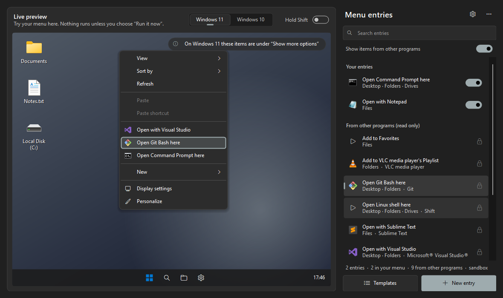
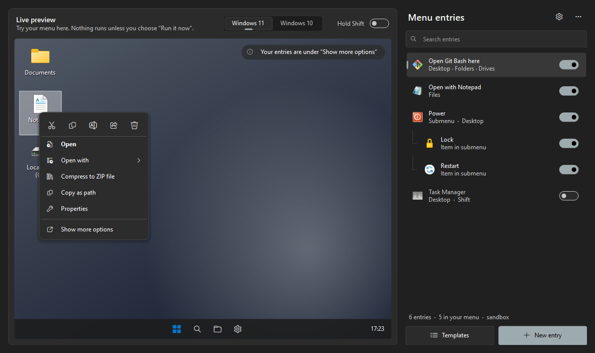
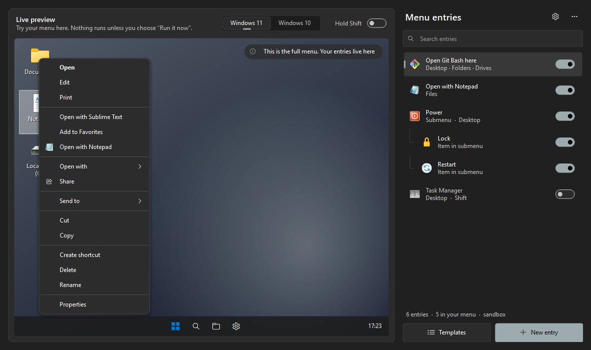
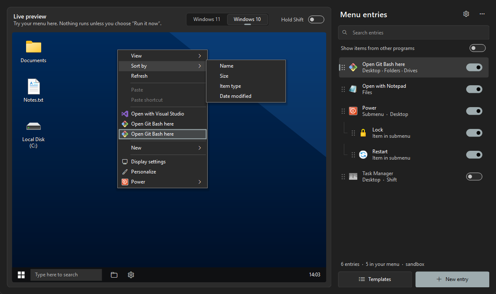

# Context Menu Manager

Add your own items to the Windows right-click menu, such as **Open Git Bash here**, **Open PowerShell here** or **Copy path**, and try them out in a live preview before you use them for real.

Free, open source and private: no ads, no tracking, no internet access, and no administrator rights needed.



## Features

- **Live preview with a demo desktop.** Right-click the pretend desktop, a folder, a file or a drive and see the menu as it will look, including the items other programs already added. Click your entry to see exactly what Windows would run, and run it for a test if you like.
- **Windows 11 and Windows 10 menus.** The preview shows the Windows 11 compact menu, then the full menu behind **Show more options**, or the Windows 10 menu.
- **Templates.** Add common entries in one click: Command Prompt, PowerShell, Windows Terminal, Git Bash, VS Code, Notepad, Copy path, Task Manager, Restart Explorer and a Power submenu. Templates for programs you don't have are greyed out.
- **Your own entries.** Pick a program, its arguments (`{path}` is the item you clicked), an icon, and where the entry shows up: desktop and folder background, folders, files (all or only some file types) or drives.
- **Submenus**, separator lines, top or bottom position, and "only when Shift is held".
- **See what other programs added.** The list also shows, read only, the menu items other programs put there (for example Git, VS Code, VLC, 7-Zip or Microsoft Defender), with the program they come from. Select one to see where it is in the menu, or make an editable copy of it.
- **Turn entries on and off** without deleting them.
- **Import and export** your entries as a JSON file. Imported entries arrive turned off, so you can check them first.
- **Full context menu on Windows 11** (optional): skip "Show more options" and always show every item.
- **Safe by design.** The app only changes registry keys it created itself (see [How it works](docs/HOW-IT-WORKS.md)) and can remove all of them with one click.
- Follows the Windows light/dark theme and accent color, works on high-DPI screens, and can be used with the keyboard.

| Windows 11 menu | Full menu ("Show more options") | Windows 10 menu |
| --- | --- | --- |
|  |  |  |

## Requirements

- Windows 10 (version 1809 or later) or Windows 11
- The [.NET 10 Desktop Runtime](https://dotnet.microsoft.com/download/dotnet/10.0), unless you use a self-contained download

## Getting started

1. Download the latest release from the [Releases page](https://github.com/XOWN3RRX/ContextMenuManager/releases) and unzip it anywhere. There is no installer.
2. Run `ContextMenuManager.exe`.
3. Click **Templates** and add, for example, *Open Command Prompt here*, or click **New entry** to make your own.
4. Try it in the live preview, then right-click your real desktop.

> **Windows 11:** entries added this way appear under **Show more options** (or Shift + right-click). Turn on **Settings → Full context menu on Windows 11** if you want to see them straight away.

The [User guide](docs/USER-GUIDE.md) explains every option with examples.

## Removing the app

Open **⋯ → Remove everything this app added** (or **Settings → Remove everything this app added**), then delete the app folder. Optionally delete `%AppData%\ContextMenuManager` too. If you turned on the full context menu on Windows 11, turn it off in Settings first.

## Building from source

Requires the [.NET 10 SDK](https://dotnet.microsoft.com/download/dotnet/10.0).

```bash
dotnet build ContextMenuManager.slnx -c Release
```

```bash
dotnet test ContextMenuManager.slnx
```

Or open `ContextMenuManager.slnx` in Visual Studio 2026. To try changes without touching your real context menu, start the app with `--sandbox` (see [CONTRIBUTING.md](CONTRIBUTING.md)).

## Documentation

- [User guide](docs/USER-GUIDE.md): how to use every feature, with examples and troubleshooting
- [How it works](docs/HOW-IT-WORKS.md): the registry keys the app writes and why it is safe
- [Contributing](CONTRIBUTING.md): build, test, project structure and pull requests
- [Security](SECURITY.md) and [Privacy](PRIVACY.md)
- [Code signing policy](docs/CODE-SIGNING.md)
- [Changelog](CHANGELOG.md)

## Code signing policy

Free code signing provided by [SignPath.io](https://about.signpath.io), certificate by [SignPath Foundation](https://signpath.org). Signing has been requested but isn't active yet. See the [code signing policy](docs/CODE-SIGNING.md) for who can approve a release and how to check a signature.

## License

[MIT](LICENSE). You can use, change and share it freely.

Windows is a trademark of Microsoft Corporation. This project is not affiliated with or endorsed by Microsoft. Program names used in templates (Git, Visual Studio Code, Notepad++, PowerShell) belong to their owners; the app only starts those programs if you have installed them.
